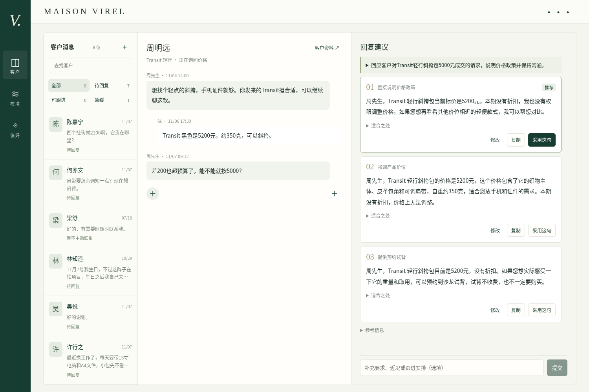
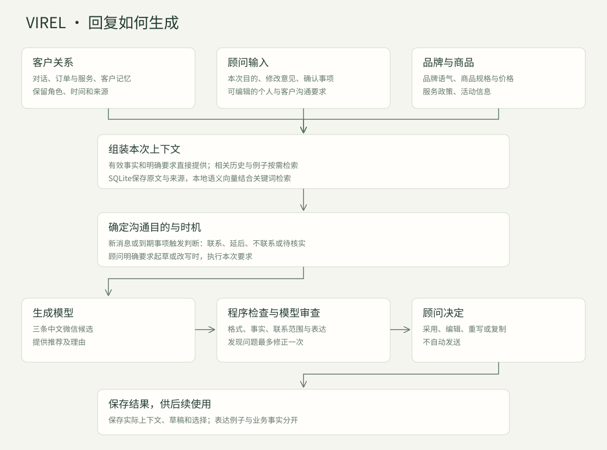

# Clienteling Workbench · 客户沟通工作台

结合客户对话、关系记忆与商品资料，为顾问准备下一条微信回复。

演示围绕虚构皮具品牌 MAISON VIREL 展开，包含商品、活动和连续客户关系。

## 演示

[演示视频 · 1分15秒](docs/demo.mp4)

## 从了解客户，到准备回复

**一段关系，持续积累。** 对话、购买记录、服务进展和客户记忆放在一起。区分客户本人和收礼人的偏好，也参考对这位客户过去采用的回复。

**三条建议，由人选择。** 根据当前问题准备不同切入点的草稿，给出推荐理由。可以直接修改，也可以补充“自然一点”“已经确认三个人能同组”，继续生成。

**到期先判断，再决定是否联系。** 新消息与约定时间触发复查；该回复时起草，需要等待时暂缓。顾问的明确指令决定本次任务。

**表达习惯可以调整。** 通过选择、修改和表达例子积累偏好；通用要求、情境要求与客户记忆均可查看、编辑和停用。

覆盖生日与节庆、商品推荐、购后关怀、重新联系、活动邀请和价格异议，也支持同一段对话中交织的多个需求。



## 三种常见情况

| 顾问面对的问题 | 工作台怎样协助 |
| --- | --- |
| 客户自己喜欢绿色，但这次给喜欢白色的姐姐买礼物 | 区分购买者与收礼人，结合容量、配色和用途推荐 |
| 客户问“5200能不能按5000？” | 先回答能否优惠，依据真实定价规则组织回复 |
| 客户说“最近先不用联系，有需要我找你” | 记录联系意愿，主动跟进到期时仍可选择等待 |

## 系统结构



品牌事实和明确要求直接进入上下文，较长的客户历史与表达例子按相关性检索。SQLite 保存原文、来源和修改记录；BGE 中文向量与关键词共同寻找参考。生成后检查格式、事实和表达，发现问题最多修正一次。

后端使用 Python、Flask 和 SQLite；前端为原生 HTML、CSS、JavaScript。默认使用 DeepSeek 完成生成与审查，检索模型在本地运行。

## 快速开始

建议使用 Python 3.11–3.13。以下命令适用于 Linux / macOS 终端，Windows 可使用 WSL；已在 Linux / Python 3.13 验证。

```bash
git clone https://github.com/Trojan-Miracle/clienteling-workbench.git
cd clienteling-workbench
python3 -m venv .venv
source .venv/bin/activate
python -m pip install -r requirements-memory.txt
```

将 [.env.example](.env.example) 复制为 `.env`，填写自己的 `DEEPSEEK_API_KEY`。已有 `.env` 不要覆盖，其余配置可保持默认。

首次运行，准备演示数据并下载中文检索模型：

```bash
python scripts/setup_demo.py
python scripts/setup_memory_retrieval.py
```

启动：

```bash
python scripts/serve_review.py --port 8791 --retrieval hybrid
```

保持终端运行，在浏览器打开 **http://127.0.0.1:8791**。如果运行在远程服务器，在 VS Code 的「端口」面板转发8791，再打开显示的本地地址。端口被占用时，可更换 `--port` 并同步修改访问地址。

演示包含8位客户和已生成的建议，查看已有内容不调用模型；新消息与改写需要可用的 API 密钥和网络连接。演示时间设在11月7日，右上角菜单可调整。

## 试一遍

1. 选一位客户，查看对话与回复建议。
2. 在右侧填写修改意见，或用对话下方的“＋”补充新消息。
3. 打开「客户资料」，查看或修改客户记忆。
4. 在「校准」里选择喜欢的表达，在「偏好」里整理要求与例子。

工作数据保存在 `artifacts/`，不会进入 Git。`setup_demo.py` 只在没有工作数据库时初始化，不会覆盖已有记录。

## 代码与测试

| 目录 | 内容 |
| --- | --- |
| `atelier/` | 客户关系、上下文检索、起草、审查与跟进 |
| `web/v6/` | 工作台界面 |
| `prompts/v6/` | 实际使用的提示词 |
| `data/v6/` | 品牌、商品、活动与演示客户设定 |
| `tests/` | 记忆、改写、跟进、任务恢复等自动测试 |

```bash
python -m unittest discover -s tests -v
```

品牌、客户和商品为演示设定。本项目面向本地单顾问使用，由顾问核对并自行发送，不接入或自动发送微信。
